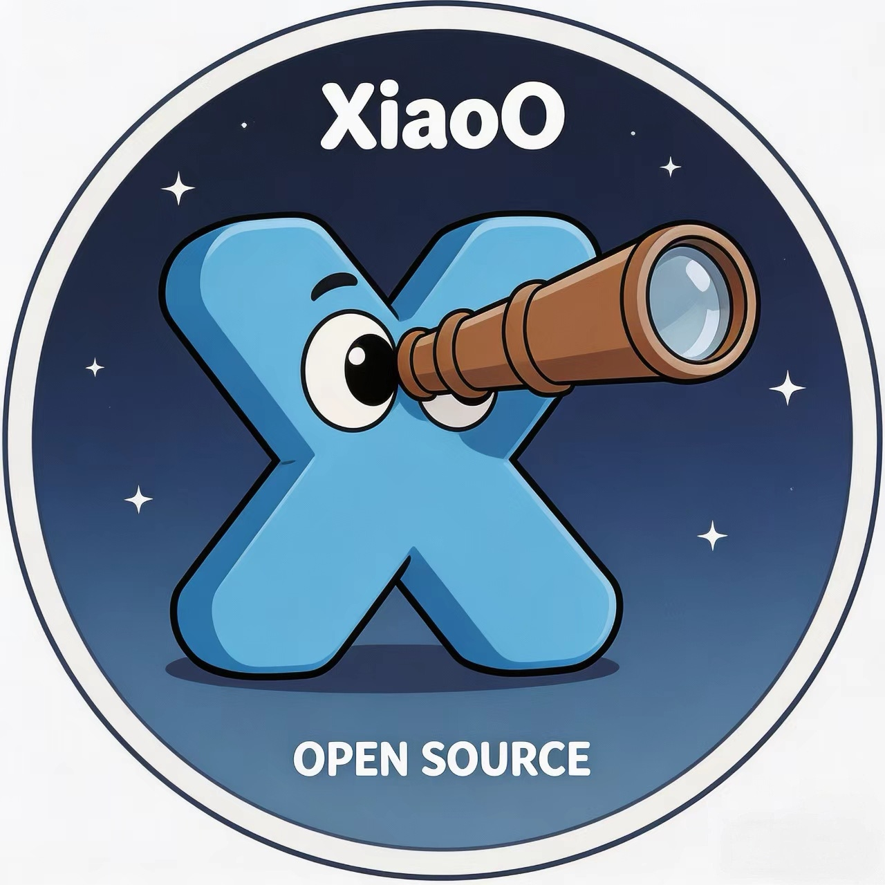

<div align="center">
  
</div>

# xiaoO

[English](./README.md) | [中文](./README.zh-CN.md)

Open-source intelligence hub for AgentOS.

[](./License/LICENSE)
[](https://www.rust-lang.org/)

## What is xiaoO?

xiaoO is the intelligence hub of AgentOS. It provides a self-governing agent runtime for system management, agent orchestration, tool execution, memory, context compression, and multi-channel access.

At its core, xiaoO turns the operating system into a practical home for agents: files, shell commands, Git, web access, LSP diagnostics, skills, hooks, channels, and runtime telemetry are exposed through one coordinated agent loop.

The runtime also includes a layered memory and adaptive context-compression system, so long conversations, tool-heavy tasks, and multi-agent collaboration can remain stable without being overwhelmed by raw history growth.

## Key Features

- Agent runtime hub: CLI, TUI, daemon, HTTP API, and channel integrations.
- Full tool suite: file operations, shell execution, code search (glob/grep), web search/browse, sub-agents, and MCP / custom TOML tool manifests.
- Adaptive context management: token-budget tracking, configured compaction, forced recovery after context-limit errors, and prefix-cache telemetry.
- Streaming reasoning: provider reasoning/thinking deltas can be surfaced while the model works.
- Reasoning-effort tiers: switch among `off`, `high`, and `max`; the TUI cycles them with `Ctrl+T`.
- Session management: save and resume long-running work.
- LSP diagnostics: inline errors and warnings after edits through servers such as `rust-analyzer`, `pyright`, `typescript-language-server`, `gopls`, and `clangd`.
- Skills system: installable instruction packs loaded from local directories or Git sources.
- Hook and plugin system: hook points around LLM calls, tool calls, slash-command execution, and chat-message/system-prompt transforms, plus session lifecycle stages (`SessionCreated`, `SessionClosed`, `SessionState`), for audit, policy, traceability, and custom extensions.
- Observability: live token/cost tracking and trace storage through `noop`, `stdout`, or `moirai-sqlite`.
- Scheduled and triggered tasks: long-running automation workflows can be attached to the runtime.
- Localized UI: a clean terminal interface designed for daily agent work.

## Prerequisites

- Rust toolchain 1.88 or newer, with Cargo installed (the lockfile pins `icu_normalizer`, `clap`, and other crates that require rustc >= 1.88).
- A supported LLM provider account or a local model endpoint.
- Provider credentials available through environment variables or the xiaoO configuration file.

## Installation

### From Source

```bash
git clone https://atomgit.com/openeuler/xiaoO.git
cd xiaoO
cargo install --path apps/endside
```

This installs the `xiaoo` binary into `~/.cargo/bin` and attempts to install builtin skills. Make sure `~/.cargo/bin` is in your `PATH`.

> **Note**: `cargo build` does NOT install skills. Only `cargo install` triggers skill installation.
>
> **Installation Behavior**:
> - First attempts to install builtin skills to system-level directory: `/usr/lib/.xiaoo/skills/` (requires root privileges)
> - If system-level installation fails (e.g., permission denied), automatically falls back to user-level directory: `~/.xiaoo/skills/`
> - Builtin skills are `xiaoo-guardian` (security policy enforcement), `block-analyzer`, and `security-rules-tester`
> - Without these skills, security features may be unavailable.
>
> **For system-wide installation** (recommended for multi-user environments):
> - Run `cargo install` with root privileges: `sudo cargo install --path apps/endside`

### Build

```bash
./build.sh --release
```

The build wrapper can install the `agent_moss` hooker, a security-audit plugin for tool execution. Once enabled, xiaoO sends every tool operation to the resident AgentMoss service on the same host for security analysis before executing it, and intercepts the execution when a dangerous operation is detected. See [docs/plugins.md](./docs/plugins.md) for plugin installation and usage.

### Uninstallation

```bash
# Uninstall binaries
cargo uninstall xiaoo-endside

# Remove builtin skills (system level requires root)
sudo rm -rf /usr/lib/.xiaoo/skills

# Or the user-level copies created by the fallback path
rm -rf ~/.xiaoo/skills/{xiaoo-guardian,block-analyzer,security-rules-tester}
```

## Quick Start

Create `~/.config/xiaoo/config.toml`:

```toml
[llm]
provider = "openrouter"              # openai, anthropic, ollama, openrouter, deepseek, zai, minimax, kimi, minimax-coding-plan, kimi-coding-plan, ...
model = "z-ai/glm-5"
api_key_env = "OPENROUTER_API_KEY"   # Read the API key from this environment variable
reasoning_effort = "off"             # Optional: off, high, or max (TUI only; CLI uses --reasoning-effort; Daemon uses HTTP API field)

# Predefined subagent roles (CLI/TUI/Daemon all support) ⭐
# More role options: docs/config_file_guide.md
[subagent.code_reviewer]
description = "Code review specialist"
prompt = "You are a code review specialist focusing on quality and best practices."
max_turns = 5
```

Optionally, configure trace storage:

```toml
[trace]
storage_backend = "moirai-sqlite"    # noop, stdout, or moirai-sqlite
db_path = "~/.xiaoo/traces.db"       # Used when storage_backend is moirai-sqlite
```

Set your provider credential:

```bash
export OPENROUTER_API_KEY="sk-or-..."
```

Setup custom api url for local LLM (entry point `http://localhost:8080/v1/chat/completions`):

```toml
[llm]
provider = "local"
model = "deepseek-v4-flash"
api_base = "http://localhost:8080/v1"
api_key_env = "LLM_API_KEY"
```

> The `local` provider defaults to `http://localhost:8080/v1` already; set
> `api_base` only when your server lives on a different port or path. If you
> omit `/v1`, the OpenAI-compatible client still probes `/v1/chat/completions`
> as a fallback after `/chat/completions` fails with a 404, but specifying it
> directly avoids the extra failed request.

Run xiaoO:

```bash
# Terminal UI
xiaoo

# Single-shot CLI
xiaoo --cli run -p "Count the characters in hello world"
```

Example CLI output:

```text
"hello world" has 11 characters.
```

> **Configuration Documentation**:
> - [General Configuration Guide](docs/config_file_guide.md) - Shared configuration for all modes (llm, subagent, skills, etc.)
> - [CLI Configuration](docs/cli_config.md) - CLI basic usage and supported configuration
> - [TUI Configuration](docs/tui_config.md) - TUI-specific configuration (remote, LSP, agent roles)
> - [Daemon Configuration](docs/daemon_config.md) - Daemon-specific configuration (channels, HTTP API)

## Docker

The image contains `xiaoo`, `xiaoo-daemon`, and `moirai`, and ships **no**
`config.toml` — mount your own at run time:

```bash
docker build -t xiaoo:latest .
docker run --rm -d -p 18080:18080 \
  -v $PWD/my.toml:/root/.config/xiaoo/config.toml:ro \
  -e OPENROUTER_API_KEY=sk-or-... \
  -e XIAOO_HTTP_BEARER_TOKEN=change-me \
  xiaoo:latest
```

The container starts `xiaoo-daemon` bound to `0.0.0.0`, so the mounted config
must set a bearer token (`[http].bearer_token` or `bearer_token_env`) and
provide the configured API key environment variable — otherwise the daemon
refuses to start. Pass `xiaoo` for the TUI (`docker run -it xiaoo:latest
xiaoo`) or `xiaoo --cli run -p "..."` for one-shot CLI; expose the read-only
dashboard with `--dashboard-host 0.0.0.0 -p 28081:28081`.
See [docs/docker_deploy.md](./docs/docker_deploy.md) for full instructions.

## Run as a Daemon

xiaoO can run as a daemon and expose a REST API for external systems such as Feishu, Telegram, or custom services. The daemon is a separate binary, installed from the same repository:

```bash
cargo install --path apps/serverside
```

```bash
# Default address: 127.0.0.1:18080 (loopback only)
xiaoo-daemon

# Specify configuration file, host, and port
xiaoo-daemon --config /path/to/config.toml --host 127.0.0.1 --port 18080
```

The runtime API can execute commands and read/write files, so it binds loopback
by default. To expose it on another interface you must configure a bearer token
(`[http].bearer_token` / `[http].bearer_token_env` or `--bearer-token-env`);
the daemon refuses to start on a non-loopback address without one. See
[docs/daemon_config.md](./docs/daemon_config.md).

The TUI's `/remote` requires the daemon to run on the **same server** as the
TUI (the connect-time health check compares host identities and rejects a
daemon on another machine). For multi-node deployment use
[xGovernor](https://atomgit.com/openeuler/xGovernor) instead of `xiaoo-daemon`;
see [docs/remote_tui.md](./docs/remote_tui.md).

HTTP requests can select an agent role preset by passing `runtime_profile_id` inside the `entry` object of the JSON body:

```json
{
  "runtime_id": "demo-runtime",
  "text": "Review this patch for security issues",
  "channel": "http",
  "sender_id": "demo-user",
  "conversation_id": "demo-conv",
  "mentions": [],
  "entry": {
    "kind": "http_api",
    "runtime_profile_id": "code-reviewer"
  }
}
```

More daemon configuration details are in [docs/daemon_config.md](./docs/daemon_config.md).

## Skills

Each skill is a reusable instruction pack backed by `SKILL.md` or `SKILL.toml`. Skills are searched at runtime across four directory levels, highest to lowest priority:

1. **Project level**: `./.xiaoo/skills/`
2. **Config level**: directories specified in `[skills].dirs`
3. **User level**: `~/.xiaoo/skills/` (default install location)
4. **System level**: `/usr/lib/.xiaoo/skills/` (built-in skills only)

```bash
xiaoo --cli skill list
xiaoo --cli skill show <name>
xiaoo --cli skill audit <path>
xiaoo --cli skill install ./my-skill/
xiaoo --cli skill install https://github.com/user/my-skill.git
xiaoo --cli skill remove <name>
```

See [docs/skill_usage.md](./docs/skill_usage.md) for the full skill workflow.

## Testing

All tests live under the repository-root `tests/` directory — functional source files carry no inline test code:

- `tests/unit/` — unit tests mirrored by crate (`<source-file>_test.rs`), attached from the source file with a one-line `#[cfg(test)] #[path = "..."] mod ...;` declaration;
- `tests/system/` — integration tests wired into crates through `[[test]]` targets.

```bash
bash tests/run.sh                 # run the full suite (cargo test --workspace)
bash tests/run.sh -p xiaoo-core   # extra args are passed through to cargo test
```

`scripts/ci.sh` is the unified CI entry for static gates: facade discipline, test hygiene (keeps test code out of `src/`), doc link checks, code formatting (`cargo fmt --check`), and Dockerfile COPY coverage; it does not compile. Layout and naming conventions are documented in [tests/README.md](./tests/README.md).

## Documentation

**Guides**

- [Skill Usage](./docs/skill_usage.md)
- [Plugin System](./docs/plugins.md)
- [MCP Integration](./docs/mcp.md)
- [Custom Tools](./docs/custom_tools.md)
- [Custom Agents](./docs/custom_agent.md)
- [Scheduled Jobs (Cron)](./docs/cron_scheduled_jobs.md)
- [Remote TUI](./docs/remote_tui.md)
- [E2B Workspace & Skills Bootstrap](./docs/e2b_workspace_skills_bootstrap.md)

**Deployment**

- [Docker Deployment](./docs/docker_deploy.md)
- [Feishu Deployment](./docs/feishu_deploy.md)
- [Telegram Deployment](./docs/telegram_deploy.md)

**Architecture & Design**

- [Architecture Overview](./docs/architecture_overview.md) — apps, workspace crates, binaries, and runtime layering
- [Memory & Context Compression](./docs/memory_context_system.md)
- [Runtime Checkpoint Control](./docs/runtime_checkpoint.md)
- [Runtime SDK Refactor (Landed)](./docs/xiaoo_api_pure_runtime_refactor.md)
- [Vault Secrets Design](./docs/vault_secrets_design.md)
- [KV Cache Coordination Design](./docs/kvcache-coordination-design.md)
- [Super Gateway Control Plane Design](./docs/super_gateway_control_plane_design.md)

## Community

To improve the efficiency of developing and maintaining xiaoO, you can apply to join the "xiaoO Enthusiasts Group" by adding WeChat: xj756386857 (remark: xiaoO enthusiast + atomgit_id).

## License

xiaoO is licensed under [MulanPSL-2.0](./License/LICENSE).
