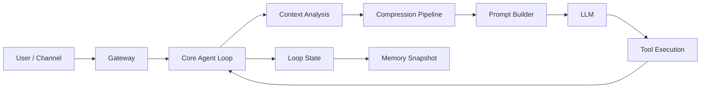

# xiaoO Memory & Context Compression

## Overview

xiaoO treats context as a managed runtime asset rather than a raw transcript. The system keeps live task state as working-memory snapshots synchronized from the loop, and compresses low-value history before it becomes a context-window failure. Long-term memory is available as an opt-in automation path backed by an external MCP server.

In practice, this gives xiaoO three core properties:

- **Working memory**: per-lane message snapshots synced from loop state and persisted with session records.
- **Adaptive compression**: auto-compact based on token pressure.
- **Opt-in long-term memory**: RAM-A automation recalls and ingests memory through an MCP server, disabled by default.

## Active Capabilities

### Enabled in the default runtime

- working-memory snapshots synchronized from loop state;
- adaptive context compression in `daemon` and `cli`;
- multi-agent lane memory isolation;
- traceable compression and prompt-build lifecycle.

Each of these is wired on the default path:

| Claim | Evidence |
| --- | --- |
| Multi-agent lane memory isolation is default-enabled | Each lane builds its own `MemoryManager` keyed by session id for the root lane and by `agent_id` for spawned subagent lanes (`apps/shared/src/gateway/session_worker.rs`). |

## Runtime Flow



Runtime sequence:

1. A turn enters the agent loop.
2. xiaoO estimates history cost against the token budget.
3. If needed, it compresses history before prompt construction.
4. The latest loop state is synchronized back into `MemorySnapshot`.

## Key Building Blocks

### Memory model

| Type | Role |
| --- | --- |
| `MemorySnapshot` | live working memory: the raw loop messages, persisted with the session record |
| `MemoryManager` | builds and syncs the working-memory snapshot |

### Compression model

| Type | Role |
| --- | --- |
| `CompressionPipeline` | runtime compression contract |
| `ContextManager` | production implementation |
| `ContextAnalysis` | token-pressure analysis result |
| `CompactionPolicy` | effective history budget policy |

## Compression Behavior

xiaoO does not use one generic truncation pass. When history exceeds the
auto-compact threshold, it summarizes the compactable range into a single dense
summary message (**Auto Compact**), preserving the protected ranges below.

The compressor explicitly protects:

- the first user task message;
- tool-use/tool-result dependencies;
- recent tail messages;
- execution continuity needed for the next turn.

If the provider still returns a context-length error, xiaoO forces a compression retry and rebuilds the prompt automatically.

## Memory Automation and the Failed-Ingest Queue

Beyond the working-memory snapshot, the daemon ships an opt-in long-term memory automation
path. It recalls memory into the turn as untrusted system context and ingests new
observations asynchronously, so a failing ingest never blocks the agent loop.

The automation config is a first-class TOML section, `[memory_automation]`
(`apps/serverside/src/daemon_config.rs`), typed as `MemoryAutomationConfig`
(`apps/shared/src/gateway/memory_automation.rs`). It is opt-in: `enabled` defaults
to `false` (`apps/shared/src/gateway/memory_automation.rs`).

Failed ingest attempts are not dropped. They go to a durable queue with bounded capacity
and bounded retries:

| Field | Default | Source |
| --- | --- | --- |
| `queue_path` | `memory-automation-queue.jsonl` | `apps/shared/src/gateway/memory_automation.rs` |
| `queue_capacity` | `256` | `apps/shared/src/gateway/memory_automation.rs` |
| `max_retries` | `5` | `apps/shared/src/gateway/memory_automation.rs` |
| `retry_backoff_ms` | `250` | `apps/shared/src/gateway/memory_automation.rs` |

The `xiaoo-daemon` binary exposes queue management for operators through
`config memory-queue` (`apps/serverside/src/main.rs`, CLI action variant at
`apps/serverside/src/main.rs`). Three actions are available — `status`,
`retry-failed`, and `clear-failed` (`apps/serverside/src/main.rs`;
`apps/serverside/src/memory_management.rs`).

```bash
xiaoo-daemon config memory-queue status
xiaoo-daemon config memory-queue retry-failed
xiaoo-daemon config memory-queue clear-failed
```

## Configuration

The daemon/CLI configuration exposes **compression settings** (`[compact]`) and the
`[memory_automation]` section.

- `[memory_automation]` is a real top-level daemon TOML section
  (`apps/serverside/src/daemon_config.rs`; type
  `apps/shared/src/gateway/memory_automation.rs`) covering recall and the
  failed-ingest queue; it is documented in
  [config_file_guide.md](./config_file_guide.md).

Compression-related options are also described in [daemon_config.md](./daemon_config.md).

| Config | Meaning |
| --- | --- |
| `[compact].auto_compact_ratio` | auto-compact threshold |
| `[compact].blocking_ratio` | final pre-overflow threshold |
| `[compact].summary_max_tokens` | summary token budget |
| `[compact].summary_preserve_tail` | tail preserved during summary |
| `[compact].summary_llm_max_tokens` | max tokens for summary generation |

Example:

```toml
[llm]
provider = "openrouter"
model = "z-ai/glm-5"
api_key_env = "OPENROUTER_API_KEY"
max_tokens = 8192

[compact]
auto_compact_ratio = 0.75
blocking_ratio = 0.9
summary_max_tokens = 1024
summary_preserve_tail = 4
summary_llm_max_tokens = 4096
```

## Usage Guide

### Enable adaptive compression

If you only need the built-in context-management path, configure `[compact]`. The context window is resolved dynamically; the daemon additionally accepts an explicit `[llm].context_window` override (`apps/serverside/src/daemon_config.rs`; schema `apps/serverside/src/config_schema.rs`), while the CLI exposes no such field. This is wired into:

- `apps/serverside/src/daemon_runtime.rs`
- `apps/endside/src/cli/mod.rs`
- `crates/core/src/agent_loop.rs`

Once configured, compression runs automatically before each turn.

## Observability

xiaoO traces context-management behavior so you can answer:

- when compression triggered;
- how much history was removed;
- whether the runtime summarized or left history untouched;
- whether a provider context-limit error triggered recovery.

This is especially useful when tuning compaction thresholds in production.

### Summary output capabilities

Summary requests use JSON mode only when the provider's existing
`ProviderCapabilities.supports_json_mode` is true. Integrators using
`OpenAiCompatibleProviderConfig` can set this capability to false for endpoints
that require ordinary text requests; the summary still must contain the same
JSON object, optionally enclosed in a Markdown code fence. Invalid JSON remains
a compression error. Providers constructed without explicit capabilities retain
their existing JSON-mode default.

The rough compression estimate includes reasoning returned with assistant tool
calls, matching the OpenAI-compatible wire conversion. When dynamic context
resolution cannot supply a window, application assembly logs a warning before
using the existing static fallback.
